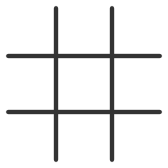

# Set up a game {.task}

Get the board ready before your first turn.

1. Place the grid between the two players.
2. Decide who will play X and who will play O.
3. Give each player their markers.
4. Choose who goes first. Traditionally, X goes first.

The game is ready to begin.
